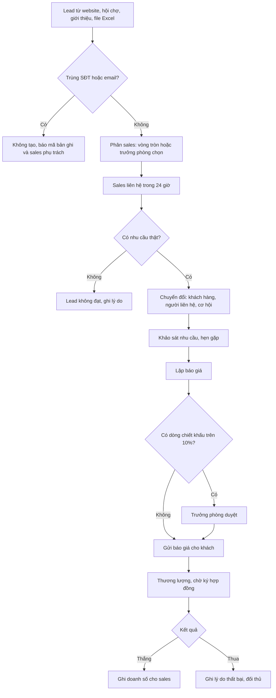
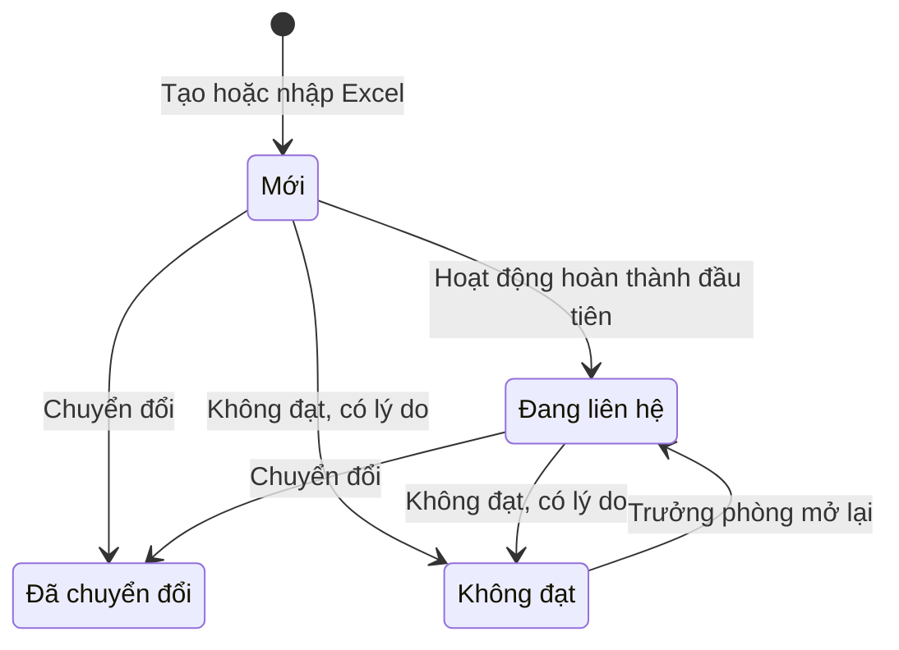
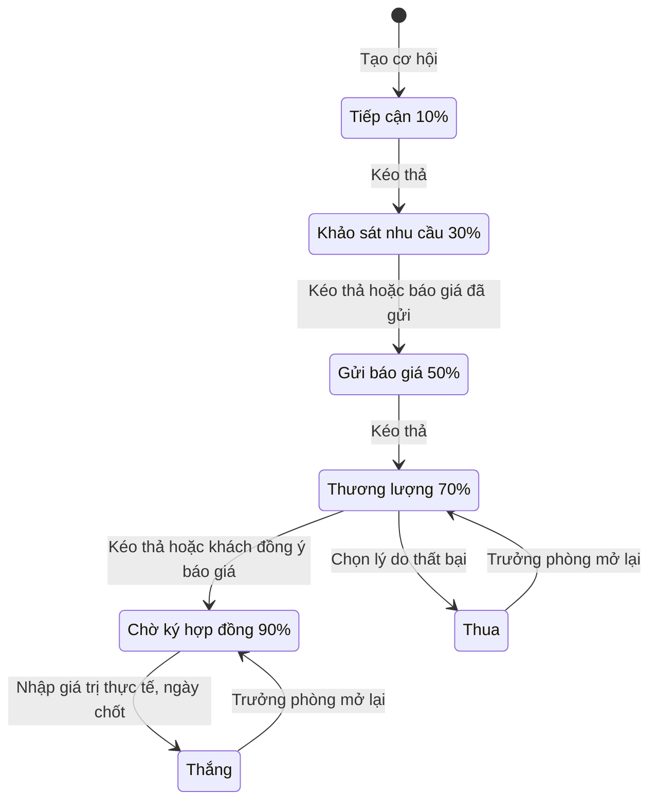
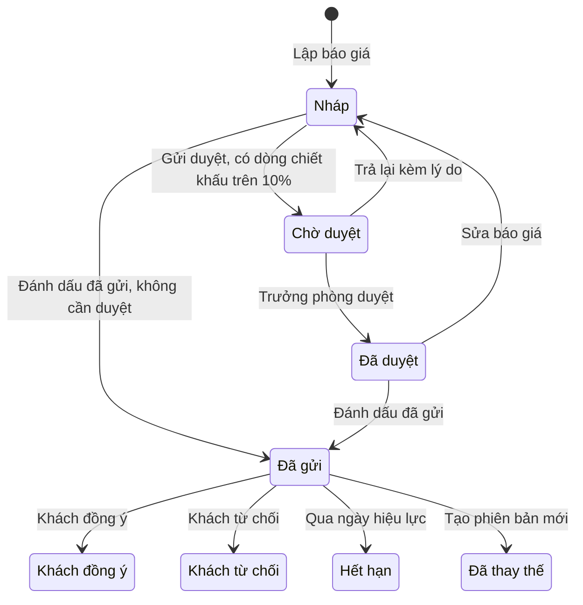

# Đặc tả yêu cầu phần mềm (SRS) — CRM Quản lý Khách hàng

| Phiên bản | Ngày | Trạng thái |
| :--- | :--- | :--- |
| 1.0 | 12/10/2026 | Bản nháp để triển khai demo |

> Cách viết, quy ước mã, mức độ chi tiết: `ZDOCS/05-HUONG-DAN/HUONG-DAN-VIET-TAI-LIEU-NGHIEP-VU.md`.
> Phần nền (đăng nhập, tài khoản, vai trò, cài đặt, đặt lại dữ liệu demo): `ZDOCS/03-KIEN-TRUC/USE-CASE-NEN.md`, không viết lại ở đây.

---

## 1. Giới thiệu

### 1.1. Mục đích

Tài liệu mô tả đầy đủ yêu cầu của bản demo CRM Quản lý Khách hàng: chức năng, quy tắc phân lead và chống trùng, pipeline cơ hội, báo giá, báo cáo, phân quyền theo phạm vi dữ liệu và danh sách màn hình. Dev dùng để code, tester dùng để viết và chạy test case, sales dùng để biết demo làm được gì.

### 1.2. Phạm vi

**Trong phạm vi:** lead (thêm, kiểm tra trùng, phân vòng tròn, nhập Excel), chuyển đổi lead, khách hàng và người liên hệ, chuyển giao khách giữa sales, pipeline cơ hội dạng Kanban, hoạt động chăm sóc và nhắc việc, báo giá có duyệt chiết khấu, chỉ tiêu doanh số, tổng quan và báo cáo. Sales chỉ thấy dữ liệu của mình.

**Ngoài phạm vi:** gửi email, SMS, Zalo thật (nút gửi chỉ giả lập), tổng đài gọi điện và ghi âm, form web và Facebook Lead Ads đổ lead tự động (giả lập bằng nhập tay và Excel), hợp đồng, đơn hàng, công nợ, hóa đơn điện tử, chia nhóm hoặc chi nhánh kinh doanh.

### 1.3. Thuật ngữ

| Thuật ngữ | Giải thích |
| :--- | :--- |
| Lead | Người hoặc doanh nghiệp để lại thông tin nhưng chưa xác minh nhu cầu, vd khách ghé gian hàng hội chợ |
| Sales | Nhân viên kinh doanh, vai trò `STAFF` |
| Trưởng phòng | Trưởng phòng kinh doanh, vai trò `MANAGER` |
| Sales phụ trách | Người chịu trách nhiệm một lead, khách hàng, cơ hội; quyết định sales nào nhìn thấy bản ghi |
| Phân lead | Giao lead cho một sales phụ trách |
| Phân vòng tròn | Chia lần lượt từng lead cho các sales theo thứ tự cố định |
| Chậm liên hệ | Lead đã phân quá 24 giờ mà chưa có hoạt động hoàn thành nào |
| Chuyển đổi lead | Tạo khách hàng, người liên hệ và (tùy chọn) cơ hội từ một lead |
| Khách hàng | Doanh nghiệp hoặc cá nhân đã có hồ sơ chính thức |
| Người liên hệ | Người làm việc tại khách hàng doanh nghiệp: giám đốc, kế toán trưởng, trưởng phòng mua hàng |
| Cơ hội | Một thương vụ với khách hàng, có giá trị dự kiến và ngày chốt dự kiến |
| Giai đoạn | Bước của cơ hội trong pipeline, mỗi giai đoạn có một xác suất thắng |
| Pipeline | Toàn bộ cơ hội đang mở, xếp theo giai đoạn |
| Giá trị gia quyền | Giá trị dự kiến nhân xác suất thắng của giai đoạn |
| Cơ hội đóng | Cơ hội ở trạng thái Thắng hoặc Thua |
| Hoạt động | Một lần chăm sóc khách: gọi điện, gặp mặt, email, Zalo; đã làm hoặc lên lịch |
| Báo giá | Chứng từ gửi khách gồm sản phẩm, số lượng, đơn giá, chiết khấu, thuế GTGT |
| Doanh số | Tổng giá trị thực tế của cơ hội Thắng |
| Chỉ tiêu | Doanh số mục tiêu của một sales trong một tháng |
| Phạm vi dữ liệu | Giới hạn bản ghi người dùng nhìn thấy, theo `DataScope` của tài khoản |

### 1.4. Tài liệu liên quan

| Tài liệu | Nội dung |
| :--- | :--- |
| `01-TONG-QUAN-NGHIEP-VU.md` | Tổng quan nghiệp vụ |
| `03-USE-CASE.md` | Đặc tả use case |
| `05-KICH-BAN-KIEM-THU.md` | Test case nghiệm thu |
| `ZDOCS/03-KIEN-TRUC/USE-CASE-NEN.md` | Phần nền dùng chung |
| `ZDOCS/03-KIEN-TRUC/KIEN-TRUC-HE-THONG.md` §7.6 | Cơ chế `DataScope` |

---

## 2. Mô tả tổng quan

### 2.1. Bối cảnh sản phẩm

Doanh nghiệp B2B hoặc B2C có phòng kinh doanh 5–30 người. Lead đến từ website, fanpage, hội chợ, người quen giới thiệu, khách gọi vào hotline. Trưởng phòng chia lead cho sales; sales gọi điện, hẹn gặp, gửi báo giá, theo cơ hội tới khi chốt. Sales làm việc trên máy tính ở văn phòng và trên điện thoại khi đi gặp khách. Trưởng phòng theo dõi pipeline, doanh số so với chỉ tiêu và hiệu quả từng người.

Dữ liệu mẫu giả định một công ty bán giải pháp phần mềm quản lý và thiết bị văn phòng cho khách doanh nghiệp, giá trị cơ hội từ 20.000.000 ₫ đến 1.500.000.000 ₫.

### 2.2. Tác nhân

| Mã vai trò | Tên | Thiết bị | Mục tiêu khi dùng hệ thống |
| :--- | :--- | :--- | :--- |
| `ADMIN` | Quản trị viên | Desktop | Cấu hình hệ thống, tài khoản, phân quyền |
| `MANAGER` | Trưởng phòng kinh doanh | Desktop | Phân lead, theo dõi pipeline toàn đội, duyệt chiết khấu, đặt chỉ tiêu, xem báo cáo, chuyển giao khách khi sales nghỉ |
| `STAFF` | Nhân viên kinh doanh | Desktop, điện thoại | Liên hệ lead nhanh, chăm sóc khách đúng hẹn, đẩy cơ hội tới chốt, đạt chỉ tiêu |

Tài khoản demo:

| Tài khoản | Vai trò | Họ tên | Ghi chú |
| :--- | :--- | :--- | :--- |
| `admin` | `ADMIN` | Quản trị viên | |
| `quanly` | `MANAGER` | Phạm Thu Trang | Trưởng phòng kinh doanh |
| `nhanvien` | `STAFF` | Nguyễn Minh Tuấn | Sales, nút "Đăng nhập nhanh" vai trò Nhân viên |
| `sales2` | `STAFF` | Lê Hoàng Yến | Sales thứ hai để demo phạm vi dữ liệu; đăng nhập bằng mật khẩu `DEMO_PASSWORD`, không có nút đăng nhập nhanh |

Dữ liệu mẫu có thêm 4 sales không dùng để đăng nhập demo: Đỗ Quang Huy, Vũ Thị Mai, Bùi Đức Long, Hoàng Ngọc Anh. Tổng 6 sales, khớp `01-TONG-QUAN-NGHIEP-VU.md` §8.

### 2.3. Quy trình nghiệp vụ

### 2.4. Giả định và ràng buộc

- Một công ty, một phòng kinh doanh: 1 trưởng phòng, 6 sales. Không chia nhóm, không chi nhánh.
- Phạm vi dữ liệu dùng cơ chế `DataScope` ở `KIEN-TRUC-HE-THONG.md` §7.6 nhưng không bật chi nhánh: chỉ dùng `All` và `Self`, bản ghi nghiệp vụ lọc theo sales phụ trách.
- Tiền tính bằng đồng (₫). Giá trị cơ hội là giá trị trước thuế GTGT.
- Giờ hệ thống theo múi giờ Việt Nam (UTC+7). Mốc "24 giờ", "14 ngày", "30 ngày" tính theo giờ lịch, không trừ ngày nghỉ.
- Nút "Gọi" dùng liên kết `tel:` để mở trình gọi điện của điện thoại; không có tổng đài, không ghi âm.
- Nút "Gửi email" báo giá chỉ giả lập: hệ thống ghi một hoạt động loại Email kèm tệp PDF, không gửi thật.
- Quy trình dừng ở cơ hội Thắng; không quản lý hợp đồng, giao hàng, công nợ.

---

## 3. Yêu cầu chức năng

### 3.1. Tổng quan

| Mã | Yêu cầu | Ưu tiên | Vai trò | UC |
| :--- | :--- | :---: | :--- | :--- |
| FR-01 | Hệ thống hiển thị 4 thẻ số: doanh số tháng này và phần trăm hoàn thành chỉ tiêu, giá trị pipeline đang mở (tổng và gia quyền), số lead mới trong tháng, tỉ lệ chuyển đổi lead 90 ngày; số liệu tính theo phạm vi dữ liệu của người xem | P1 | MANAGER, STAFF | UC-12 |
| FR-02 | Tổng quan có khối "Việc cần làm" gồm hoạt động hôm nay, hoạt động quá hạn, lead chậm liên hệ, cơ hội có ngày chốt dự kiến trong 7 ngày tới; bấm một dòng mở bản ghi tương ứng | P1 | MANAGER, STAFF | UC-12 |
| FR-03 | Tổng quan của trưởng phòng có bảng xếp hạng sales tháng này: doanh số, phần trăm chỉ tiêu, số cơ hội thắng, số hoạt động hoàn thành | P2 | MANAGER | UC-12 |

### 3.2. Lead

| Mã | Yêu cầu | Ưu tiên | Vai trò | UC |
| :--- | :--- | :---: | :--- | :--- |
| FR-04 | Hệ thống cho phép sales và trưởng phòng thêm, sửa lead gồm họ tên, SĐT, email, công ty, chức vụ, tỉnh/thành, nguồn, nhu cầu, ngân sách dự kiến, mức quan tâm (Nóng, Ấm, Lạnh), ghi chú | P1 | MANAGER, STAFF | UC-01 |
| FR-05 | Khi thêm, sửa lead, hệ thống chuẩn hóa SĐT, email và kiểm tra trùng; trùng thì không lưu, báo mã bản ghi trùng và tên sales phụ trách | P1 | MANAGER, STAFF | UC-01 |
| FR-06 | Danh sách lead lọc theo trạng thái, nguồn, sales phụ trách, mức quan tâm, khoảng ngày tạo, nhãn "Chậm liên hệ"; tìm theo tên, SĐT, email, công ty; lead chậm liên hệ có nhãn đỏ | P1 | MANAGER, STAFF | UC-01 |
| FR-07 | Chi tiết lead hiển thị thông tin, dòng thời gian hoạt động, lịch sử phân; có nút Gọi, Ghi hoạt động, Chuyển đổi, Không đạt | P1 | MANAGER, STAFF | UC-01 |
| FR-08 | Sales đánh dấu lead "Không đạt" với lý do bắt buộc; trưởng phòng mở lại lead "Không đạt" về "Đang liên hệ" | P1 | MANAGER, STAFF | UC-01 |
| FR-09 | Khi bật phân tự động, lead do trưởng phòng tạo không chọn sales hoặc lead nhập từ Excel được hệ thống phân vòng tròn cho sales | P1 | Hệ thống | UC-02 |
| FR-10 | Trưởng phòng phân hoặc phân lại một hay nhiều lead cùng lúc cho một sales; sales nhận thông báo trong ứng dụng; lịch sử phân lưu người phân và thời điểm | P1 | MANAGER | UC-02 |
| FR-11 | Trưởng phòng bật/tắt phân tự động, chọn và sắp thứ tự sales nhận lead, đặt ngưỡng lead "Mới" tối đa mỗi sales | P2 | MANAGER | UC-02 |
| FR-12 | Trưởng phòng nhập lead từ file Excel theo mẫu: tải file mẫu, xem trước kết quả kiểm tra từng dòng (hợp lệ, lỗi, trùng), xác nhận nhập dòng hợp lệ, tải file các dòng không nhập kèm cột lý do | P2 | MANAGER | UC-03 |

### 3.3. Chuyển đổi lead, khách hàng, người liên hệ

| Mã | Yêu cầu | Ưu tiên | Vai trò | UC |
| :--- | :--- | :---: | :--- | :--- |
| FR-13 | Sales chuyển đổi lead: tạo khách hàng mới hoặc gắn vào khách hàng có sẵn, tạo người liên hệ từ thông tin lead, tùy chọn tạo cơ hội; lead chuyển "Đã chuyển đổi" và liên kết tới khách hàng | P1 | MANAGER, STAFF | UC-04 |
| FR-14 | Hệ thống cho phép thêm, sửa khách hàng loại Doanh nghiệp (tên, MST, ngành, quy mô, địa chỉ, tỉnh/thành, SĐT, email, website) hoặc Cá nhân (họ tên, SĐT, email, ngày sinh, địa chỉ), kèm nguồn và sales phụ trách | P1 | MANAGER, STAFF | UC-05 |
| FR-15 | Danh sách khách hàng lọc theo loại, tỉnh/thành, ngành, sales phụ trách, nhãn "Cần chăm sóc"; tìm theo tên, MST, SĐT, email | P1 | MANAGER, STAFF | UC-05 |
| FR-16 | Hồ sơ khách hàng có tab Thông tin, Người liên hệ, Cơ hội, Hoạt động, Báo giá; đầu trang hiển thị doanh số đã thắng, số cơ hội đang mở, ngày tương tác gần nhất | P1 | MANAGER, STAFF | UC-05 |
| FR-17 | Hệ thống cho phép thêm, sửa, xóa người liên hệ của khách hàng doanh nghiệp: họ tên, chức vụ, SĐT, email, ngày sinh, liên hệ chính | P1 | MANAGER, STAFF | UC-05 |
| FR-18 | Trưởng phòng đổi sales phụ trách một khách hàng, hoặc chuyển giao toàn bộ khách hàng và lead của một sales sang sales khác | P2 | MANAGER | UC-06 |

### 3.4. Cơ hội và pipeline

| Mã | Yêu cầu | Ưu tiên | Vai trò | UC |
| :--- | :--- | :---: | :--- | :--- |
| FR-19 | Hệ thống cho phép tạo, sửa cơ hội: tên, khách hàng, người liên hệ, giá trị dự kiến, ngày chốt dự kiến, sản phẩm quan tâm, ghi chú; giai đoạn ban đầu "Tiếp cận"; sales phụ trách là sales của khách hàng | P1 | MANAGER, STAFF | UC-07 |
| FR-20 | Pipeline dạng Kanban gồm 5 cột giai đoạn mở và 2 vùng thả "Thắng", "Thua"; đầu cột hiển thị số cơ hội, tổng giá trị, giá trị gia quyền; thẻ hiển thị tên, khách hàng, giá trị, ngày chốt dự kiến, sales, nhãn "Quá hạn chốt", "Nguội" | P1 | MANAGER, STAFF | UC-07, UC-08 |
| FR-21 | Người dùng kéo thả thẻ để đổi giai đoạn; xác suất cập nhật theo giai đoạn; hệ thống ghi lịch sử chuyển giai đoạn | P1 | MANAGER, STAFF | UC-08 |
| FR-22 | Thả thẻ vào "Thắng" mở hộp nhập giá trị thực tế và ngày chốt; thả vào "Thua" mở hộp chọn lý do thất bại và đối thủ | P1 | MANAGER, STAFF | UC-08 |
| FR-23 | Pipeline lọc theo sales, khách hàng, khoảng ngày chốt dự kiến, nhãn; chuyển được sang dạng bảng sắp xếp theo giá trị, ngày chốt | P1 | MANAGER, STAFF | UC-08 |
| FR-24 | Trưởng phòng mở lại cơ hội đã Thắng hoặc Thua | P2 | MANAGER | UC-08 |

### 3.5. Hoạt động chăm sóc

| Mã | Yêu cầu | Ưu tiên | Vai trò | UC |
| :--- | :--- | :---: | :--- | :--- |
| FR-25 | Sales ghi nhận hoạt động đã làm (Gọi điện, Gặp mặt, Email, Zalo/Tin nhắn) gắn với lead, khách hàng hoặc cơ hội, kèm kết quả và ghi chú | P1 | MANAGER, STAFF | UC-09 |
| FR-26 | Sales lên lịch hoạt động sắp tới: loại, tiêu đề, thời gian bắt đầu, thời lượng, nhắc trước, đối tượng liên quan, người phụ trách | P1 | MANAGER, STAFF | UC-09 |
| FR-27 | Màn hình Hoạt động có tab Hôm nay, Quá hạn, Sắp tới, Đã xong; người dùng đánh dấu hoàn thành kèm kết quả và tạo luôn hoạt động tiếp theo | P1 | MANAGER, STAFF | UC-09 |
| FR-28 | Hệ thống gửi thông báo trong ứng dụng khi đến giờ nhắc, khi được phân lead, khi báo giá được gửi duyệt, được duyệt hoặc bị trả lại | P2 | MANAGER, STAFF | UC-10 |
| FR-29 | Màn hình Hoạt động có dạng lịch tuần, tháng; kéo thả để đổi giờ hoạt động chưa hoàn thành | P2 | MANAGER, STAFF | UC-10 |

### 3.6. Báo giá

| Mã | Yêu cầu | Ưu tiên | Vai trò | UC |
| :--- | :--- | :---: | :--- | :--- |
| FR-30 | Trưởng phòng quản lý danh mục sản phẩm, dịch vụ: mã, tên, đơn vị tính, đơn giá, thuế suất mặc định, trạng thái đang bán hoặc ngừng bán | P2 | MANAGER | UC-11 |
| FR-31 | Sales lập báo giá từ cơ hội: chọn sản phẩm, số lượng, đơn giá, chiết khấu dòng, thuế suất; hệ thống tính tiền ngay khi nhập; nhập hạn hiệu lực, điều khoản thanh toán, ghi chú | P2 | MANAGER, STAFF | UC-11 |
| FR-32 | Báo giá có chiết khấu vượt hạn mức phải gửi trưởng phòng duyệt; trưởng phòng duyệt hoặc trả lại kèm lý do | P2 | MANAGER, STAFF | UC-11 |
| FR-33 | Sales in, xuất PDF báo giá khổ A4 có thông tin doanh nghiệp và đánh dấu "Đã gửi"; nút "Gửi email" chỉ giả lập | P2 | MANAGER, STAFF | UC-11 |
| FR-34 | Sales ghi nhận khách đồng ý hoặc từ chối báo giá; tạo phiên bản mới từ báo giá đã gửi | P2 | MANAGER, STAFF | UC-11 |

### 3.7. Báo cáo và chỉ tiêu

| Mã | Yêu cầu | Ưu tiên | Vai trò | UC |
| :--- | :--- | :---: | :--- | :--- |
| FR-35 | Báo cáo doanh số theo sales và theo tháng trong khoảng chọn, so với chỉ tiêu và kỳ liền trước cùng độ dài | P1 | MANAGER | UC-13 |
| FR-36 | Báo cáo phễu chuyển đổi: số lead, lead chuyển đổi, có cơ hội, cơ hội thắng và tỉ lệ từng bước; xem theo nguồn lead và theo sales | P1 | MANAGER | UC-13 |
| FR-37 | Báo cáo pipeline (số cơ hội, giá trị, giá trị gia quyền theo giai đoạn, dự báo theo tháng chốt dự kiến), báo cáo hoạt động theo sales và thống kê lý do thất bại | P2 | MANAGER | UC-13 |
| FR-38 | Trưởng phòng đặt chỉ tiêu doanh số theo tháng cho từng sales | P2 | MANAGER | UC-14 |
| FR-39 | Trưởng phòng xuất danh sách lead, khách hàng, báo cáo đang xem ra Excel; sales không có chức năng này | P3 | MANAGER | UC-15 |

---

## 4. Quy tắc nghiệp vụ

| Mã | Quy tắc | Áp dụng cho |
| :--- | :--- | :--- |
| BR-01 | Chuẩn hóa SĐT: bỏ khoảng trắng và các ký tự `.` `-` `(` `)`; đầu `+84` hoặc `84` đổi thành `0`. Sau chuẩn hóa, SĐT hợp lệ khi là di động 10 số bắt đầu bằng `03`, `05`, `07`, `08`, `09` hoặc cố định 11 số bắt đầu bằng `02`. Chuẩn hóa email: bỏ khoảng trắng hai đầu, đổi về chữ thường, đúng dạng `ten@mien.duoi`. Hệ thống lưu giá trị đã chuẩn hóa | FR-04, FR-05, FR-12, FR-14, FR-17 |
| BR-02 | Lead bắt buộc có họ tên (2–100 ký tự) và ít nhất một trong hai: SĐT hoặc email | FR-04, FR-12 |
| BR-03 | Lead trùng khi SĐT hoặc email đã chuẩn hóa trùng với một lead chưa "Không đạt", một khách hàng hoặc một người liên hệ. Lead trùng không được lưu; thông báo chỉ nêu mã bản ghi trùng và tên sales phụ trách. Khách hàng, người liên hệ trùng SĐT hoặc email chỉ cảnh báo, người dùng xác nhận thì vẫn lưu | FR-05, FR-12, FR-14, FR-17 |
| BR-04 | Phân vòng tròn: lead mới giao cho sales kế tiếp sau người nhận gần nhất trong danh sách nhận lead (theo thứ tự cấu hình, hết danh sách thì quay lại đầu). Bỏ qua sales bị khóa tài khoản hoặc đang giữ số lead "Mới" bằng hoặc vượt ngưỡng (mặc định 30, cấu hình 5–100). Người nhận gần nhất không còn trong danh sách thì bắt đầu từ người đầu danh sách. Không còn ai đủ điều kiện thì lead để "Chưa phân" và báo trưởng phòng. Lead do sales tự tạo giao cho chính sales đó; lead phân thủ công và lead sales tự tạo không làm dịch lượt vòng tròn | FR-09, FR-10, FR-11 |
| BR-05 | Lead "Mới" quá 24 giờ kể từ thời điểm phân mà chưa có hoạt động hoàn thành thì gắn nhãn "Chậm liên hệ". Phân lại lead thì mốc 24 giờ tính lại từ lần phân mới. Nhãn mất khi có hoạt động hoàn thành | FR-02, FR-06 |
| BR-06 | Trạng thái lead: "Mới" tự chuyển "Đang liên hệ" khi có hoạt động hoàn thành đầu tiên. "Mới" hoặc "Đang liên hệ" chuyển "Đã chuyển đổi" khi chuyển đổi, hoặc "Không đạt" kèm lý do bắt buộc (Không liên lạc được, Không có nhu cầu, Ngân sách không phù hợp, Đã mua của đối thủ, Thông tin sai). Chỉ trưởng phòng mở lại lead "Không đạt", lead về "Đang liên hệ". Lead "Đã chuyển đổi" chỉ xem, không sửa | FR-08, FR-13, FR-25 |
| BR-07 | Chuyển đổi lead: hệ thống tìm khách hàng có tên trùng tên công ty của lead (không phân biệt hoa thường, bỏ khoảng trắng thừa) hoặc trùng MST; có thì gợi ý gắn vào khách đó. Khách hàng trùng thuộc sales khác thì không gắn được và không chuyển đổi được, người dùng phải báo trưởng phòng. Lead không có công ty tạo khách hàng Cá nhân. Khách hàng mới nhận sales phụ trách của lead. Hoạt động của lead hiển thị tiếp trong hồ sơ khách hàng | FR-13 |
| BR-08 | MST khách hàng doanh nghiệp gồm 10 chữ số, hoặc 10 chữ số + `-` + 3 chữ số (chi nhánh), vd `0312345678-001`; không bắt buộc nhưng không được trùng. Khách hàng doanh nghiệp có ít nhất một người liên hệ thì có đúng một liên hệ chính; chọn người khác làm liên hệ chính thì người cũ tự bỏ | FR-14, FR-17 |
| BR-09 | Khách hàng không có hoạt động hoàn thành nào trong 30 ngày gần nhất thì gắn nhãn "Cần chăm sóc". Khách tạo chưa đủ 30 ngày tính từ ngày tạo | FR-15, FR-16 |
| BR-10 | Giai đoạn và xác suất thắng cố định: Tiếp cận 10%, Khảo sát nhu cầu 30%, Gửi báo giá 50%, Thương lượng 70%, Chờ ký hợp đồng 90%, Thắng 100%, Thua 0%. Kéo tự do tiến hoặc lùi giữa 5 giai đoạn mở; thả vào Thắng hoặc Thua được từ mọi giai đoạn mở | FR-20, FR-21 |
| BR-11 | Giá trị dự kiến của cơ hội lớn hơn 0, là bội số của 1.000 ₫, tính trước thuế GTGT. Giá trị gia quyền = giá trị dự kiến × xác suất của giai đoạn. Tổng đầu cột và tổng pipeline chỉ gồm cơ hội đang mở trong phạm vi dữ liệu của người xem | FR-19, FR-20 |
| BR-12 | Thắng: bắt buộc giá trị thực tế lớn hơn 0 (gợi ý bằng tổng trước thuế của báo giá "Khách đồng ý", không có thì bằng giá trị dự kiến) và ngày chốt không sau hôm nay. Thua: bắt buộc lý do (Giá cao, Chọn đối thủ, Không có ngân sách, Hoãn dự án, Không liên lạc được, Khác); chọn "Chọn đối thủ" thì nhập tên đối thủ, chọn "Khác" thì nhập ghi chú. Cơ hội đóng chỉ xem. Chỉ trưởng phòng mở lại; cơ hội về giai đoạn mở cuối cùng trước khi đóng, xóa giá trị thực tế hoặc lý do thua | FR-22, FR-24 |
| BR-13 | Cơ hội đang mở có ngày chốt dự kiến trước hôm nay thì gắn nhãn "Quá hạn chốt". Cơ hội đang mở không có hoạt động hoàn thành nào trong 14 ngày (tính từ ngày tạo nếu chưa có) thì gắn nhãn "Nguội" | FR-02, FR-20 |
| BR-14 | Phạm vi dữ liệu: `STAFF` có `DataScope = Self`, chỉ xem, tìm, sửa lead, khách hàng (kèm người liên hệ), cơ hội, báo giá có sales phụ trách là mình, và hoạt động mình phụ trách hoặc gắn với bản ghi của mình. `ADMIN`, `MANAGER` có `DataScope = All`. Lọc áp ở máy chủ cho danh sách, chi tiết, tìm kiếm, tổng quan, báo cáo, xuất file. Mở bản ghi ngoài phạm vi bằng URL thì hiển thị "Không tìm thấy bản ghi". Ngoại lệ duy nhất là thông báo trùng (BR-03, BR-07) nêu mã bản ghi và tên sales phụ trách | Mọi FR có dữ liệu |
| BR-15 | Đổi sales phụ trách khách hàng: cơ hội đang mở, báo giá chưa có kết quả, hoạt động "Kế hoạch" của khách chuyển theo sales mới; cơ hội đã đóng và hoạt động đã hoàn thành giữ người cũ để doanh số và thống kê lịch sử không đổi. Chuyển giao toàn bộ từ sales A sang sales B thì áp quy tắc trên cho mọi khách của A và chuyển thêm lead chưa chuyển đổi của A | FR-18 |
| BR-16 | Hoạt động "Kế hoạch" có thời gian bắt đầu đã qua thì hiển thị "Quá hạn". Hoàn thành hoạt động bắt buộc nhập kết quả; với Gọi điện, kết quả chọn một trong: Đã trao đổi, Không nghe máy, Thuê bao, Hẹn gọi lại. Sales ghi nhận hoạt động đã làm với thời gian trong 7 ngày gần nhất, không ở tương lai; trưởng phòng không giới hạn 7 ngày. Lên lịch hoạt động phải có thời gian bắt đầu sau hiện tại | FR-25, FR-26, FR-27 |
| BR-17 | Nhắc trước: Không nhắc, 15 phút (mặc định), 1 giờ, 1 ngày. Thông báo chỉ trong ứng dụng; email, Zalo ngoài phạm vi demo | FR-26, FR-28 |
| BR-18 | Tiền báo giá: thành tiền dòng = số lượng × đơn giá × (100% − chiết khấu dòng), làm tròn đến 1 ₫. Thuế dòng = thành tiền dòng × thuế suất (Không chịu thuế, 0%, 5%, 8%, 10%), làm tròn đến 1 ₫. Tổng tiền hàng = Σ số lượng × đơn giá. Tổng chiết khấu = tổng tiền hàng − tổng trước thuế. Tổng trước thuế = Σ thành tiền dòng. Tổng thuế = Σ thuế dòng. Tổng thanh toán = tổng trước thuế + tổng thuế. Làm tròn: phần lẻ từ 0,5 ₫ trở lên làm tròn lên | FR-31 |
| BR-19 | Chiết khấu dòng từ 0% đến 30%, nhập tối đa 1 chữ số thập phân. Báo giá do `STAFF` lập có ít nhất một dòng chiết khấu trên 10% thì phải được trưởng phòng duyệt trước khi gửi. Báo giá do trưởng phòng lập không cần duyệt | FR-31, FR-32 |
| BR-20 | Trạng thái báo giá: Nháp → Chờ duyệt (khi cần duyệt) → Đã duyệt hoặc trả về Nháp kèm lý do; Nháp (không cần duyệt) hoặc Đã duyệt → Đã gửi → Khách đồng ý, Khách từ chối, hoặc Hết hạn (tự động khi qua ngày hiệu lực). Sửa báo giá Đã duyệt thì về Nháp. Báo giá từ Đã gửi trở đi không sửa; "Tạo phiên bản mới" sao chép thành bản Nháp mã `{mã gốc}-{n}`, bản đang Đã gửi chuyển "Đã thay thế". Hạn hiệu lực mặc định 15 ngày kể từ ngày báo giá, cho phép 1–90 ngày | FR-32, FR-33, FR-34 |
| BR-21 | Báo giá gắn với một cơ hội đang mở; không lập báo giá cho cơ hội đã đóng. Đánh dấu "Đã gửi": cơ hội đang ở Tiếp cận hoặc Khảo sát nhu cầu tự chuyển sang Gửi báo giá. "Khách đồng ý": giá trị dự kiến của cơ hội lấy bằng tổng trước thuế của báo giá; cơ hội ở giai đoạn thấp hơn Chờ ký hợp đồng tự chuyển sang Chờ ký hợp đồng. Mỗi cơ hội có tối đa một báo giá "Khách đồng ý" | FR-22, FR-33, FR-34 |
| BR-22 | Chỉ số báo cáo: doanh số kỳ = Σ giá trị thực tế của cơ hội Thắng có ngày chốt trong kỳ, ghi cho sales phụ trách lúc thắng. Tỉ lệ chuyển đổi lead = số lead tạo trong kỳ đang ở "Đã chuyển đổi" ÷ số lead tạo trong kỳ. Tỉ lệ thắng = số cơ hội Thắng ÷ (Thắng + Thua) trong các cơ hội đóng trong kỳ. Chu kỳ bán hàng = trung bình số ngày từ tạo tới chốt của cơ hội Thắng trong kỳ, làm tròn tới ngày. Phần trăm làm tròn 1 chữ số thập phân; mẫu số bằng 0 thì hiển thị "—" | FR-01, FR-03, FR-35, FR-36, FR-37 |
| BR-23 | Chỉ tiêu đặt theo sales, theo tháng, là bội số của 1.000.000 ₫. Chỉ tiêu đội = tổng chỉ tiêu các sales. Phần trăm chỉ tiêu = doanh số tháng ÷ chỉ tiêu × 100%; chưa có chỉ tiêu thì hiển thị "—" | FR-01, FR-03, FR-35, FR-38 |
| BR-24 | Nhập Excel: file `.xlsx` không quá 5 MB, tối đa 1.000 dòng dữ liệu, đúng dòng tiêu đề của file mẫu. Dòng lỗi: vi phạm BR-01, BR-02, hoặc tên đăng nhập sales không tồn tại. Dòng trùng dữ liệu có sẵn bị bỏ qua; các dòng trùng nhau trong cùng file thì giữ dòng xuất hiện trước. Nguồn bỏ trống thì gán "Nhập Excel". Cột sales có giá trị thì giao cho sales đó, bỏ trống thì phân theo BR-04. Nhập là một giao dịch: lỗi giữa chừng thì không nhập dòng nào | FR-12 |
| BR-25 | Chỉ xóa được lead "Mới" chưa có hoạt động. Không xóa khách hàng đã có cơ hội hoặc báo giá. Không xóa người liên hệ đang gắn với cơ hội đang mở. Không xóa sản phẩm đã có trong báo giá, chỉ chuyển "Ngừng bán" | FR-04, FR-14, FR-17, FR-30 |
| BR-26 | Mã chứng từ tự sinh theo §5.3, không trùng, không dùng lại khi bản ghi bị xóa | FR-04, FR-14, FR-19, FR-31 |

---

## 5. Yêu cầu dữ liệu

### 5.1. Thực thể

| Thực thể | Mô tả | Thuộc tính chính | Quan hệ |
| :--- | :--- | :--- | :--- |
| Lead | Khách hàng tiềm năng | Mã, họ tên, SĐT, email, công ty, chức vụ, tỉnh/thành, nguồn, nhu cầu, ngân sách dự kiến, mức quan tâm, trạng thái, lý do không đạt, thời điểm phân, ghi chú | Do một sales phụ trách (có thể chưa phân); có nhiều hoạt động; có nhiều lịch sử phân; chuyển đổi thành một khách hàng |
| Lịch sử phân lead | Một lần giao lead | Thời điểm, sales cũ, sales mới, người phân (hoặc "Hệ thống"), ghi chú | Thuộc một lead |
| Cấu hình phân lead | Quy tắc phân tự động | Bật/tắt, danh sách sales theo thứ tự, ngưỡng lead Mới, sales nhận gần nhất | Một bản ghi cho cả hệ thống |
| Khách hàng | Doanh nghiệp hoặc cá nhân | Mã, loại, tên, MST, ngành, quy mô, địa chỉ, tỉnh/thành, SĐT, email, website, ngày sinh (cá nhân), nguồn, ngày tương tác gần nhất | Do một sales phụ trách; có nhiều người liên hệ, cơ hội, hoạt động, báo giá; có thể sinh từ một lead |
| Người liên hệ | Người làm việc tại khách hàng doanh nghiệp | Họ tên, chức vụ, SĐT, email, ngày sinh, liên hệ chính | Thuộc một khách hàng |
| Cơ hội | Thương vụ | Mã, tên, giá trị dự kiến, ngày chốt dự kiến, giai đoạn, xác suất, sản phẩm quan tâm, giá trị thực tế, ngày chốt thực tế, lý do thua, đối thủ, ghi chú, ngày tạo | Thuộc một khách hàng; có thể gắn một người liên hệ; do một sales phụ trách; có thể sinh từ một lead; có nhiều báo giá, hoạt động, lịch sử giai đoạn |
| Lịch sử giai đoạn | Một lần đổi giai đoạn | Giai đoạn cũ, giai đoạn mới, người đổi, thời điểm | Thuộc một cơ hội |
| Hoạt động | Một lần chăm sóc | Loại, tiêu đề, thời gian bắt đầu, thời lượng, nhắc trước, trạng thái (Kế hoạch, Hoàn thành, Hủy), kết quả, ghi chú, thời điểm hoàn thành | Gắn với một lead, khách hàng hoặc cơ hội; do một người phụ trách |
| Sản phẩm, dịch vụ | Mặt hàng đưa vào báo giá | Mã, tên, nhóm, đơn vị tính, đơn giá, thuế suất mặc định, trạng thái | Có trong nhiều dòng báo giá |
| Báo giá | Chứng từ báo giá | Mã, phiên bản, ngày báo giá, hạn hiệu lực, điều khoản thanh toán, tổng tiền hàng, tổng chiết khấu, tổng trước thuế, tổng thuế, tổng thanh toán, trạng thái, người duyệt, lý do trả lại, ghi chú | Thuộc một cơ hội và một khách hàng; có nhiều dòng báo giá |
| Dòng báo giá | Một mặt hàng trong báo giá | Tên sản phẩm, đơn vị tính, số lượng, đơn giá, chiết khấu %, thuế suất, thành tiền, tiền thuế | Thuộc một báo giá; tham chiếu một sản phẩm |
| Chỉ tiêu doanh số | Mục tiêu tháng | Tháng, năm, số tiền | Thuộc một sales |
| Thông báo | Thông báo trong ứng dụng | Loại, nội dung, liên kết, đã đọc, thời điểm | Gửi cho một người dùng |

Dòng báo giá lưu tên, đơn giá, thuế suất tại thời điểm lập. Đổi giá trong danh mục sau này không làm thay đổi báo giá cũ.

### 5.2. Vòng đời

**Lead**

Lead "Mới" chưa có sales phụ trách hiển thị nhãn "Chưa phân"; đây là bộ lọc, không phải trạng thái riêng.

**Cơ hội**

Sơ đồ chỉ vẽ đường thường gặp. Theo BR-10, kéo lùi giữa các giai đoạn mở được phép, và từ mọi giai đoạn mở đều thả được vào Thắng hoặc Thua. Mở lại đưa cơ hội về giai đoạn mở cuối cùng trước khi đóng (BR-12).

**Báo giá**

**Hoạt động:** Kế hoạch → Hoàn thành (có kết quả) hoặc Hủy (có lý do). "Quá hạn" là nhãn tính theo thời gian (BR-16), không phải trạng thái lưu.

### 5.3. Mã chứng từ

| Chứng từ | Định dạng | Ví dụ |
| :--- | :--- | :--- |
| Lead | `LD` + `yyMMdd` + 3 số thứ tự trong ngày | `LD261012007` |
| Khách hàng | `KH` + 5 số | `KH00153` |
| Cơ hội | `CH` + `yyMMdd` + 3 số thứ tự trong ngày | `CH261012002` |
| Báo giá | `BG` + `yyMMdd` + 3 số; phiên bản sau thêm `-2`, `-3`… | `BG261012001`, `BG261012001-2` |
| Sản phẩm, dịch vụ | `SP`, `DV` hoặc `TB` + 3 số | `SP001`, `DV001`, `TB001` |

---

## 6. Báo cáo

| Báo cáo | Chỉ số | Bộ lọc | Vai trò |
| :--- | :--- | :--- | :--- |
| Tổng quan | Doanh số tháng, phần trăm chỉ tiêu, pipeline tổng và gia quyền, lead mới tháng, tỉ lệ chuyển đổi 90 ngày, việc cần làm, xếp hạng sales (trưởng phòng) | — | MANAGER (toàn đội), STAFF (của mình) |
| Doanh số | Doanh số theo tháng và theo sales, chỉ tiêu, phần trăm chỉ tiêu, số cơ hội thắng, giá trị trung bình, chu kỳ bán hàng, so kỳ trước | Khoảng tháng, sales | MANAGER |
| Phễu chuyển đổi | Lead → Đã chuyển đổi → Có cơ hội → Thắng, tỉ lệ từng bước, tỉ lệ thắng | Khoảng ngày, nguồn lead, sales | MANAGER |
| Pipeline và dự báo | Số cơ hội, tổng giá trị, gia quyền theo giai đoạn; dự báo gia quyền theo tháng chốt dự kiến; cơ hội quá hạn chốt, nguội | Sales, khoảng ngày chốt | MANAGER |
| Hoạt động | Số cuộc gọi, gặp mặt, email, Zalo hoàn thành; số quá hạn; theo sales, theo tuần | Khoảng ngày, sales, loại | MANAGER |
| Lý do thất bại | Số cơ hội thua, giá trị thua theo lý do, theo đối thủ | Khoảng ngày, sales | MANAGER |

---

## 7. Phân quyền

> Quyền nền (`dashboard`, `users`, `roles`, `settings`, `audit-logs`) xem `USE-CASE-NEN.md` §7.

**Phạm vi dữ liệu** (BR-14)

| Vai trò | `DataScope` | Nhìn thấy |
| :--- | :--- | :--- |
| `ADMIN` | `All` | Toàn bộ |
| `MANAGER` | `All` | Toàn bộ lead (kể cả chưa phân), khách hàng, cơ hội, hoạt động, báo giá của đội |
| `STAFF` | `Self` | Bản ghi có sales phụ trách là mình; hoạt động mình phụ trách hoặc gắn với bản ghi của mình |

**Ma trận quyền**

| Mã quyền | Mô tả | ADMIN | MANAGER | STAFF |
| :--- | :--- | :---: | :---: | :---: |
| `leads.view` | Xem lead (theo phạm vi dữ liệu) | ✓ | ✓ | ✓ |
| `leads.create` / `update` | Thêm, sửa lead | ✓ | ✓ | ✓ |
| `leads.delete` | Xóa lead "Mới" chưa có hoạt động | ✓ | ✓ | |
| `leads.assign` | Phân, phân lại lead, cấu hình phân tự động | ✓ | ✓ | |
| `leads.import` | Nhập lead từ Excel | ✓ | ✓ | |
| `leads.convert` | Chuyển đổi lead | ✓ | ✓ | ✓ |
| `leads.reopen` | Mở lại lead "Không đạt" | ✓ | ✓ | |
| `leads.export` | Xuất danh sách lead | ✓ | ✓ | |
| `customers.view` | Xem khách hàng, người liên hệ (theo phạm vi dữ liệu) | ✓ | ✓ | ✓ |
| `customers.create` / `update` | Thêm, sửa khách hàng | ✓ | ✓ | ✓ |
| `customers.delete` | Xóa khách hàng chưa có cơ hội, báo giá | ✓ | ✓ | |
| `customers.transfer` | Đổi sales phụ trách, chuyển giao khách hàng | ✓ | ✓ | |
| `customers.export` | Xuất danh sách khách hàng | ✓ | ✓ | |
| `contacts.create` / `update` / `delete` | Quản lý người liên hệ của khách trong phạm vi | ✓ | ✓ | ✓ |
| `opportunities.view` | Xem pipeline, cơ hội (theo phạm vi dữ liệu) | ✓ | ✓ | ✓ |
| `opportunities.create` / `update` | Tạo, sửa, đổi giai đoạn, đóng cơ hội | ✓ | ✓ | ✓ |
| `opportunities.delete` | Xóa cơ hội chưa có báo giá | ✓ | ✓ | |
| `opportunities.reopen` | Mở lại cơ hội đã đóng | ✓ | ✓ | |
| `activities.view` / `create` / `update` / `delete` | Hoạt động chăm sóc (theo phạm vi dữ liệu) | ✓ | ✓ | ✓ |
| `quotes.view` / `create` / `update` | Lập, sửa, gửi báo giá (theo phạm vi dữ liệu) | ✓ | ✓ | ✓ |
| `quotes.approve` | Duyệt, trả lại báo giá vượt chiết khấu | ✓ | ✓ | |
| `products.view` | Xem danh mục sản phẩm, dịch vụ | ✓ | ✓ | ✓ |
| `products.create` / `update` / `delete` | Quản lý danh mục sản phẩm, dịch vụ | ✓ | ✓ | |
| `sales-targets.view` / `update` | Xem, đặt chỉ tiêu doanh số | ✓ | ✓ | |
| `reports.view` | Xem báo cáo | ✓ | ✓ | |
| `reports.export` | Xuất báo cáo ra Excel | ✓ | ✓ | |

Sales vẫn thấy chỉ tiêu và phần trăm hoàn thành của chính mình trên Tổng quan (quyền nền `dashboard.view`), không cần `sales-targets.view`.

---

## 8. Yêu cầu phi chức năng

> Yêu cầu chung (bảo mật JWT, phân quyền, tiếng Việt, chế độ dữ liệu mẫu) theo `ZDOCS/03-KIEN-TRUC/KIEN-TRUC-HE-THONG.md`. Ở đây chỉ ghi yêu cầu riêng của dự án.

| Mã | Yêu cầu |
| :--- | :--- |
| NFR-01 | Pipeline hiển thị mượt tới 300 thẻ đang mở; kéo thả cập nhật giao diện ngay, dưới 100 ms, không chờ máy chủ; máy chủ báo lỗi thì thẻ trả về cột cũ và hiện thông báo |
| NFR-02 | Danh sách lead, khách hàng phân trang ở máy chủ, 20 dòng mỗi trang; tìm theo tên, SĐT trả kết quả dưới 1 giây với 10.000 bản ghi |
| NFR-03 | Chi tiết lead, hồ sơ khách hàng, màn Hoạt động dùng được trên điện thoại rộng 375 px; nút Gọi mở trình gọi điện qua `tel:`; ghi kết quả cuộc gọi không quá 3 lần chạm |
| NFR-04 | Phạm vi dữ liệu (BR-14) áp ở máy chủ cho mọi API: danh sách, chi tiết, tìm kiếm, tổng quan, báo cáo, xuất file. Ẩn hiện ở FE chỉ để tiện dùng, không phải lớp bảo vệ |
| NFR-05 | Nhập 1.000 dòng Excel kiểm tra xong dưới 10 giây, có thanh tiến trình |
| NFR-06 | Bản in báo giá khổ A4 dọc, số tiền ngăn cách hàng nghìn bằng dấu chấm, có dòng "Bằng chữ" cho tổng thanh toán, 20 dòng sản phẩm vẫn vừa một trang |
| NFR-07 | Dữ liệu mẫu: 300 lead, 150 khách hàng, 120 cơ hội đủ các giai đoạn, khoảng 1.000 hoạt động trải đều 90 ngày; tỉ lệ chuyển đổi lead khoảng 20–30%, tỉ lệ thắng khoảng 30–40%; mỗi sales có chỉ tiêu 3 tháng trước và tháng hiện tại |

---

## 9. Danh sách màn hình

| Mã | Màn hình | Route | Vai trò | Thiết bị | UC |
| :--- | :--- | :--- | :--- | :--- | :--- |
| SCR-01 | Tổng quan kinh doanh | `/dashboard` | MANAGER, STAFF | Desktop, điện thoại | UC-12 |
| SCR-02 | Danh sách lead | `/leads` | MANAGER, STAFF | Desktop, điện thoại | UC-01, UC-02, UC-15 |
| SCR-03 | Chi tiết lead | `/leads` (ngăn chi tiết) | MANAGER, STAFF | Desktop, điện thoại | UC-01, UC-04, UC-09 |
| SCR-04 | Hộp chuyển đổi lead | `/leads` (hộp thoại) | MANAGER, STAFF | Desktop | UC-04 |
| SCR-05 | Hộp phân lead, quy tắc phân tự động | `/leads` (hộp thoại) | MANAGER | Desktop | UC-02 |
| SCR-06 | Nhập lead từ Excel | `/leads/import` | MANAGER | Desktop | UC-03 |
| SCR-07 | Danh sách khách hàng, hộp chuyển giao | `/customers` | MANAGER, STAFF | Desktop, điện thoại | UC-05, UC-06, UC-15 |
| SCR-08 | Hồ sơ khách hàng (tab Thông tin, Người liên hệ, Cơ hội, Hoạt động, Báo giá) | `/customers/[id]` | MANAGER, STAFF | Desktop, điện thoại | UC-04, UC-05, UC-06, UC-07, UC-09 |
| SCR-09 | Pipeline cơ hội (Kanban, dạng bảng) | `/pipeline` | MANAGER, STAFF | Desktop | UC-07, UC-08 |
| SCR-10 | Chi tiết cơ hội | `/pipeline` (ngăn chi tiết) | MANAGER, STAFF | Desktop | UC-07, UC-08, UC-09, UC-11 |
| SCR-11 | Hoạt động (tab Hôm nay, Quá hạn, Sắp tới, Đã xong, Lịch) | `/activities` | MANAGER, STAFF | Desktop, điện thoại | UC-09, UC-10 |
| SCR-12 | Danh sách báo giá, tab Sản phẩm dịch vụ | `/quotes` | MANAGER, STAFF | Desktop | UC-11 |
| SCR-13 | Soạn báo giá, bản in A4 | `/quotes/[id]` | MANAGER, STAFF | Desktop, máy in A4 | UC-11 |
| SCR-14 | Báo cáo (tab Doanh số, Phễu chuyển đổi, Pipeline, Hoạt động, Lý do thất bại, Chỉ tiêu) | `/reports` | MANAGER | Desktop | UC-13, UC-14, UC-15 |
| SCR-15 | Chuông thông báo (trên header) | — | MANAGER, STAFF | Desktop, điện thoại | UC-02, UC-10, UC-11 |
