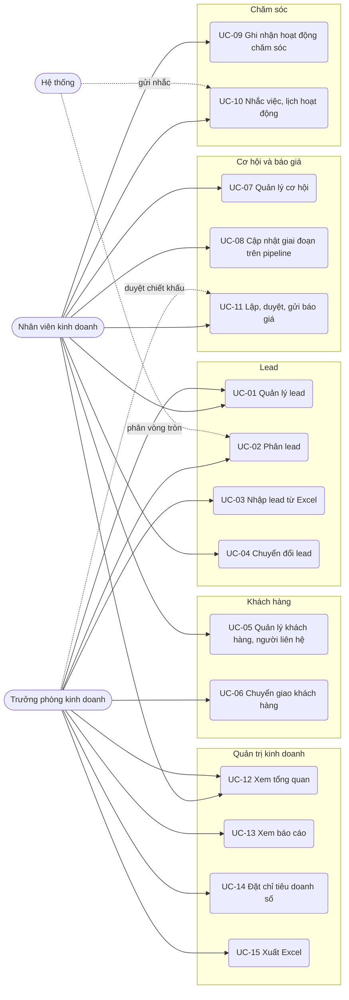

# Đặc tả use case — CRM Quản lý Khách hàng

> Use case phần nền (UC-SYS-01 đến UC-SYS-10): `ZDOCS/03-KIEN-TRUC/USE-CASE-NEN.md`.
> Mã FR, BR, SCR tham chiếu `02-SRS.md`.

---

## 1. Tác nhân

| Tác nhân | Mã vai trò | Use case chính |
| :--- | :--- | :--- |
| Nhân viên kinh doanh (sales) | `STAFF` | UC-01, UC-04, UC-05, UC-07, UC-08, UC-09, UC-10, UC-11, UC-12 |
| Trưởng phòng kinh doanh | `MANAGER` | UC-01, UC-02, UC-03, UC-04, UC-05, UC-06, UC-07, UC-08, UC-09, UC-11 (duyệt), UC-12, UC-13, UC-14, UC-15 |
| Hệ thống | — | UC-02 (phân tự động), UC-10 (gửi nhắc) |
| Quản trị viên | `ADMIN` | Toàn bộ, cộng phần nền |

---

## 2. Sơ đồ use case

Trưởng phòng làm được mọi việc của sales (UC-04, UC-05, UC-07, UC-08, UC-09) trên toàn bộ dữ liệu; sơ đồ không vẽ lại các đường này cho gọn.

---

## 3. Danh sách use case

| Mã | Tên | Tác nhân chính | Module | Ưu tiên | FR |
| :--- | :--- | :--- | :--- | :---: | :--- |
| UC-01 | Quản lý lead | Sales, Trưởng phòng | Lead | P1 | FR-04, FR-05, FR-06, FR-07, FR-08 |
| UC-02 | Phân lead | Trưởng phòng, Hệ thống | Lead | P1 | FR-09, FR-10, FR-11 |
| UC-03 | Nhập lead từ Excel | Trưởng phòng | Lead | P2 | FR-12 |
| UC-04 | Chuyển đổi lead | Sales | Lead | P1 | FR-13 |
| UC-05 | Quản lý khách hàng, người liên hệ | Sales | Khách hàng | P1 | FR-14, FR-15, FR-16, FR-17 |
| UC-06 | Chuyển giao khách hàng | Trưởng phòng | Khách hàng | P2 | FR-18 |
| UC-07 | Quản lý cơ hội | Sales | Cơ hội và báo giá | P1 | FR-19, FR-20 |
| UC-08 | Cập nhật giai đoạn trên pipeline | Sales | Cơ hội và báo giá | P1 | FR-20, FR-21, FR-22, FR-23, FR-24 |
| UC-09 | Ghi nhận hoạt động chăm sóc | Sales | Chăm sóc | P1 | FR-25, FR-26, FR-27 |
| UC-10 | Nhắc việc, lịch hoạt động | Sales, Hệ thống | Chăm sóc | P2 | FR-28, FR-29 |
| UC-11 | Lập, duyệt, gửi báo giá | Sales | Cơ hội và báo giá | P2 | FR-30, FR-31, FR-32, FR-33, FR-34 |
| UC-12 | Xem tổng quan | Trưởng phòng, Sales | Quản trị kinh doanh | P1 | FR-01, FR-02, FR-03 |
| UC-13 | Xem báo cáo | Trưởng phòng | Quản trị kinh doanh | P1 | FR-35, FR-36, FR-37 |
| UC-14 | Đặt chỉ tiêu doanh số | Trưởng phòng | Quản trị kinh doanh | P2 | FR-38 |
| UC-15 | Xuất Excel | Trưởng phòng | Quản trị kinh doanh | P3 | FR-39 |

---

## 4. Đặc tả chi tiết

### UC-01: Quản lý lead

| Mục | Nội dung |
| :--- | :--- |
| Tác nhân chính | Sales, Trưởng phòng |
| Mô tả | Thêm, sửa, tìm lead; xem chi tiết; đánh dấu không đạt, mở lại |
| Ưu tiên | P1 |
| Điều kiện kích hoạt | Có người hỏi qua hotline, website, fanpage, hội chợ, người quen giới thiệu |
| Tiền điều kiện | Có quyền `leads.create` hoặc `leads.update` |
| Hậu điều kiện | Lead được lưu, không trùng, có sales phụ trách hoặc chờ phân |
| Yêu cầu liên quan | FR-04, FR-05, FR-06, FR-07, FR-08, BR-01, BR-02, BR-03, BR-04, BR-05, BR-06, BR-14, BR-25, BR-26 |
| Màn hình | SCR-02, SCR-03 |

**Luồng chính (sales thêm lead)**

1. Sales mở Lead; hệ thống hiển thị lead trong phạm vi của mình (BR-14), mặc định lọc trạng thái Mới và Đang liên hệ, lead mới nhất lên đầu; lead chậm liên hệ có nhãn đỏ (BR-05).
2. Sales bấm "Thêm lead", nhập họ tên, SĐT, email, công ty, chức vụ, tỉnh/thành, chọn nguồn (Website, Facebook, Zalo, Hội chợ, Giới thiệu, Gọi đến, Nhập Excel, Khác), nhu cầu, ngân sách dự kiến, mức quan tâm.
3. Khi rời ô SĐT hoặc email, hệ thống chuẩn hóa giá trị (BR-01) và kiểm tra trùng (BR-03).
4. Sales bấm "Lưu"; hệ thống cấp mã lead (BR-26), trạng thái "Mới", sales phụ trách là chính sales đó (BR-04), ghi thời điểm phân.
5. Lead hiện ở đầu danh sách; ngăn chi tiết mở ra để sales gọi điện và ghi hoạt động đầu tiên (UC-09).

**Luồng thay thế**

- 1a. Tìm, lọc: gõ tên, SĐT (định dạng nào cũng được, hệ thống chuẩn hóa trước khi tìm), email, công ty; lọc theo trạng thái, nguồn, sales, mức quan tâm, ngày tạo, nhãn "Chậm liên hệ".
- 2a. Trưởng phòng thêm lead: có thêm ô "Sales phụ trách"; để trống thì hệ thống phân theo UC-02.
- 4a. Sửa lead: mở chi tiết, bấm "Sửa", đổi thông tin, lưu; đổi SĐT hoặc email thì kiểm tra trùng lại.
- 5a. Không đạt: trong chi tiết bấm "Không đạt", chọn lý do (BR-06), nhập ghi chú; lead chuyển "Không đạt" và rời bộ lọc mặc định.
- 5b. Mở lại: trưởng phòng lọc trạng thái "Không đạt", mở lead, bấm "Mở lại"; lead về "Đang liên hệ".

**Luồng ngoại lệ**

- E1. Thiếu họ tên hoặc thiếu cả SĐT và email: báo lỗi, không lưu (BR-02).
- E2. SĐT sai định dạng sau chuẩn hóa: báo "Số điện thoại không hợp lệ" tại ô. Email sai dạng: báo "Email không hợp lệ".
- E3. Trùng: báo "Trùng {SĐT hoặc email} với {mã bản ghi} do {tên sales} phụ trách", nút Lưu bị khóa. Sales không mở được bản ghi trùng nếu ngoài phạm vi của mình (BR-14).
- E4. Lead "Đã chuyển đổi": các ô chỉ đọc, có liên kết sang hồ sơ khách hàng.
- E5. Sales không có nút "Mở lại" ở lead "Không đạt".

### UC-02: Phân lead

| Mục | Nội dung |
| :--- | :--- |
| Tác nhân chính | Trưởng phòng |
| Tác nhân phụ | Hệ thống (phân tự động) |
| Mô tả | Giao lead cho sales theo vòng tròn hoặc thủ công, có kiểm soát số lead đang giữ |
| Ưu tiên | P1 |
| Điều kiện kích hoạt | Có lead chưa phân; sales nghỉ phép, quá tải hoặc chậm liên hệ |
| Tiền điều kiện | Có quyền `leads.assign` (thủ công); phân tự động đang bật (tự động) |
| Hậu điều kiện | Lead có sales phụ trách, sales nhận thông báo, lịch sử phân được ghi |
| Yêu cầu liên quan | FR-09, FR-10, FR-11, BR-04, BR-05, BR-14 |
| Màn hình | SCR-02, SCR-05, SCR-15 |

**Luồng chính (phân thủ công)**

1. Trưởng phòng mở Lead, lọc "Chưa phân", "Chậm liên hệ" hoặc theo sales.
2. Tick chọn một hoặc nhiều lead, bấm "Phân cho".
3. Hệ thống mở hộp chọn sales; mỗi sales hiển thị số lead "Mới" đang giữ và ngưỡng.
4. Trưởng phòng chọn sales, nhập ghi chú (không bắt buộc), bấm "Xác nhận".
5. Hệ thống đổi sales phụ trách, đặt lại thời điểm phân (mốc 24 giờ của BR-05), ghi lịch sử phân, gửi thông báo trong ứng dụng cho sales nhận.

**Luồng thay thế**

- 1a. Phân tự động: lead do trưởng phòng tạo mà không chọn sales, hoặc lead nhập Excel bỏ trống cột sales, khi phân tự động đang bật thì hệ thống chọn sales theo BR-04, ghi lịch sử "Hệ thống phân", gửi thông báo cho sales nhận.
- 1b. Cấu hình (P2): bấm "Quy tắc phân lead"; bật/tắt phân tự động, chọn sales tham gia, kéo thả thứ tự, đặt ngưỡng lead "Mới" (5–100, mặc định 30), lưu.
- 4a. Phân lại lead "Đang liên hệ": hoạt động "Kế hoạch" chưa làm của lead chuyển sang sales mới; hoạt động đã hoàn thành giữ người làm cũ.

**Luồng ngoại lệ**

- E1. Không còn sales đủ điều kiện (đều chạm ngưỡng hoặc bị khóa): lead để "Chưa phân", trưởng phòng nhận thông báo "Có {n} lead chưa phân được".
- E2. Danh sách chọn có lead "Đã chuyển đổi" hoặc "Không đạt": hệ thống bỏ qua các lead đó và báo số lượng bị bỏ qua.
- E3. Sales bị khóa tài khoản không có trong danh sách chọn.
- E4. Sales không có nút "Phân cho" và "Quy tắc phân lead".

### UC-03: Nhập lead từ Excel

| Mục | Nội dung |
| :--- | :--- |
| Tác nhân chính | Trưởng phòng |
| Mô tả | Đưa danh sách lead từ hội chợ, sự kiện, file cũ vào hệ thống một lần, tự loại dòng lỗi và trùng |
| Ưu tiên | P2 |
| Yêu cầu liên quan | FR-12, BR-01, BR-02, BR-03, BR-04, BR-24 |
| Màn hình | SCR-06 |

**Luồng chính**

1. Trưởng phòng mở Lead, bấm "Nhập Excel"; hệ thống mở trang nhập có nút "Tải file mẫu".
2. Trưởng phòng điền file theo mẫu (Họ tên, SĐT, Email, Công ty, Chức vụ, Tỉnh/thành, Nguồn, Nhu cầu, Ghi chú, Sales phụ trách), chọn file, bấm "Kiểm tra".
3. Hệ thống đọc file, hiển thị 3 tab Hợp lệ, Lỗi, Trùng kèm số dòng; dòng lỗi hoặc trùng có cột lý do (BR-24).
4. Trưởng phòng bấm "Nhập {n} dòng hợp lệ".
5. Hệ thống tạo lead, phân sales theo cột Sales phụ trách hoặc vòng tròn (BR-04), hiển thị tổng kết và nút "Tải file dòng không nhập".

### UC-04: Chuyển đổi lead

| Mục | Nội dung |
| :--- | :--- |
| Tác nhân chính | Sales |
| Mô tả | Biến lead có nhu cầu thật thành khách hàng, người liên hệ và cơ hội |
| Ưu tiên | P1 |
| Điều kiện kích hoạt | Lead xác nhận có nhu cầu, đồng ý gặp hoặc nhận báo giá |
| Tiền điều kiện | Lead ở "Mới" hoặc "Đang liên hệ", trong phạm vi của sales; có quyền `leads.convert` |
| Hậu điều kiện | Có khách hàng, người liên hệ chính, cơ hội "Tiếp cận" (nếu chọn); lead "Đã chuyển đổi" |
| Yêu cầu liên quan | FR-13, BR-06, BR-07, BR-08, BR-11, BR-14, BR-26 |
| Màn hình | SCR-03, SCR-04, SCR-08 |

**Luồng chính**

1. Sales mở chi tiết lead, bấm "Chuyển đổi".
2. Hệ thống mở hộp chuyển đổi gồm 3 phần Khách hàng, Người liên hệ, Cơ hội. Phần Khách hàng điền sẵn tên công ty, tỉnh/thành, nguồn từ lead; loại Doanh nghiệp nếu lead có công ty, Cá nhân nếu không.
3. Hệ thống tìm khách hàng có sẵn trùng tên công ty hoặc MST (BR-07); không có thì chọn sẵn "Tạo khách hàng mới".
4. Phần Người liên hệ điền sẵn họ tên, chức vụ, SĐT, email, đánh dấu liên hệ chính.
5. Sales bật "Tạo cơ hội", nhập tên cơ hội (gợi ý "{nhu cầu} — {tên công ty}"), giá trị dự kiến (gợi ý bằng ngân sách của lead), ngày chốt dự kiến (mặc định hôm nay + 30 ngày).
6. Sales bấm "Chuyển đổi"; hệ thống tạo khách hàng (mã `KH`), người liên hệ, cơ hội giai đoạn "Tiếp cận" có liên kết tới lead nguồn; lead chuyển "Đã chuyển đổi".
7. Hệ thống mở hồ sơ khách hàng vừa tạo; tab Hoạt động có cả các hoạt động đã ghi khi còn là lead.

**Luồng thay thế**

- 3a. Có khách hàng trùng trong phạm vi của sales: hệ thống gợi ý "Gắn vào {tên khách hàng}"; sales chọn gắn thì không tạo khách hàng mới, chỉ thêm người liên hệ và cơ hội vào khách đó.
- 5a. Chưa muốn tạo cơ hội: tắt "Tạo cơ hội"; chỉ tạo khách hàng và người liên hệ.

**Luồng ngoại lệ**

- E1. Khách hàng trùng thuộc sales khác: báo "Khách hàng {mã} do {tên sales} phụ trách, liên hệ trưởng phòng", nút "Chuyển đổi" bị khóa (BR-07).
- E2. Lead "Không đạt" hoặc "Đã chuyển đổi": không có nút "Chuyển đổi".
- E3. Giá trị dự kiến không lớn hơn 0, không là bội số 1.000 ₫, hoặc ngày chốt dự kiến trước hôm nay: báo lỗi tại ô (BR-11).
- E4. MST nhập ở phần Khách hàng sai định dạng hoặc trùng: báo lỗi tại ô (BR-08).

### UC-05: Quản lý khách hàng, người liên hệ

| Mục | Nội dung |
| :--- | :--- |
| Tác nhân chính | Sales |
| Mô tả | Thêm, sửa, tìm khách hàng; quản lý người liên hệ; xem hồ sơ 360 độ |
| Ưu tiên | P1 |
| Điều kiện kích hoạt | Có khách hàng mới không qua lead, cần cập nhật thông tin, chuẩn bị gặp khách |
| Tiền điều kiện | Có quyền `customers.view`; thêm, sửa cần `customers.create`, `customers.update` |
| Hậu điều kiện | Hồ sơ khách hàng đầy đủ, có liên hệ chính |
| Yêu cầu liên quan | FR-14, FR-15, FR-16, FR-17, BR-01, BR-03, BR-08, BR-09, BR-14, BR-25, BR-26 |
| Màn hình | SCR-07, SCR-08 |

**Luồng chính (thêm khách hàng doanh nghiệp)**

1. Sales mở Khách hàng; hệ thống hiển thị khách trong phạm vi, cột: mã, tên, loại, tỉnh/thành, sales phụ trách, doanh số đã thắng, tương tác gần nhất, nhãn "Cần chăm sóc" (BR-09).
2. Sales bấm "Thêm khách hàng", chọn loại Doanh nghiệp, nhập tên, MST, ngành, quy mô (Dưới 10, 10–49, 50–199, 200–999, Từ 1.000 người), địa chỉ, tỉnh/thành, SĐT, email, website, nguồn.
3. Bấm "Lưu"; hệ thống kiểm tra BR-08, cấp mã `KH`, sales phụ trách là người tạo.
4. Hệ thống mở hồ sơ khách hàng ở tab Người liên hệ; sales bấm "Thêm người liên hệ", nhập họ tên, chức vụ, SĐT, email, ngày sinh, tick "Liên hệ chính".
5. Đầu hồ sơ hiển thị doanh số đã thắng, số cơ hội đang mở, ngày tương tác gần nhất; các tab Cơ hội, Hoạt động, Báo giá liệt kê dữ liệu của khách.

**Luồng thay thế**

- 1a. Lọc "Cần chăm sóc" để lên danh sách gọi lại trong ngày.
- 2a. Khách cá nhân: nhập họ tên, SĐT, email, ngày sinh, địa chỉ; hồ sơ không có tab Người liên hệ.
- 4a. Đổi liên hệ chính: tick người khác; người cũ tự bỏ dấu liên hệ chính (BR-08).
- 4b. Sửa, xóa người liên hệ: bấm biểu tượng trên dòng, xác nhận.

**Luồng ngoại lệ**

- E1. MST sai định dạng hoặc trùng: báo lỗi tại ô, không lưu (BR-08).
- E2. SĐT hoặc email trùng khách hàng hoặc người liên hệ khác: cảnh báo kèm mã bản ghi; sales bấm "Vẫn lưu" thì lưu (BR-03).
- E3. Xóa khách hàng đã có cơ hội hoặc báo giá, xóa người liên hệ đang gắn với cơ hội đang mở: hệ thống từ chối, nêu lý do (BR-25).
- E4. Sales mở URL hồ sơ khách hàng của sales khác: hiển thị "Không tìm thấy bản ghi" (BR-14).

### UC-06: Chuyển giao khách hàng

| Mục | Nội dung |
| :--- | :--- |
| Tác nhân chính | Trưởng phòng |
| Mô tả | Đổi sales phụ trách một khách, hoặc chuyển toàn bộ khách và lead của sales nghỉ việc sang người khác |
| Ưu tiên | P2 |
| Yêu cầu liên quan | FR-18, BR-15 |
| Màn hình | SCR-07, SCR-08 |

**Luồng chính (chuyển giao toàn bộ)**

1. Trưởng phòng mở Khách hàng, bấm "Chuyển giao".
2. Chọn sales chuyển đi và sales nhận; hệ thống hiển thị số khách hàng, lead chưa chuyển đổi, cơ hội đang mở, báo giá chưa có kết quả, hoạt động kế hoạch sẽ chuyển.
3. Trưởng phòng bấm "Xác nhận"; hệ thống chuyển theo BR-15, ghi nhật ký, gửi thông báo cho sales nhận.

Đổi sales cho một khách: mở hồ sơ khách hàng, bấm "Đổi sales phụ trách", chọn sales, xác nhận; áp cùng BR-15.

### UC-07: Quản lý cơ hội

| Mục | Nội dung |
| :--- | :--- |
| Tác nhân chính | Sales |
| Mô tả | Tạo, sửa cơ hội; theo dõi cơ hội quá hạn chốt, nguội |
| Ưu tiên | P1 |
| Điều kiện kích hoạt | Khách có nhu cầu mua cụ thể |
| Tiền điều kiện | Có quyền `opportunities.create`; khách hàng trong phạm vi của sales |
| Hậu điều kiện | Cơ hội ở giai đoạn "Tiếp cận", xuất hiện trên pipeline |
| Yêu cầu liên quan | FR-19, FR-20, BR-10, BR-11, BR-13, BR-14, BR-26 |
| Màn hình | SCR-08, SCR-09, SCR-10 |

**Luồng chính**

1. Sales bấm "Thêm cơ hội" ở Pipeline hoặc ở tab Cơ hội của hồ sơ khách hàng.
2. Nhập tên cơ hội, chọn khách hàng (chỉ khách trong phạm vi), người liên hệ của khách, giá trị dự kiến, ngày chốt dự kiến, sản phẩm quan tâm (chọn nhiều từ danh mục), ghi chú.
3. Bấm "Lưu"; hệ thống cấp mã `CH`, giai đoạn "Tiếp cận", xác suất 10%, sales phụ trách là sales của khách hàng.
4. Thẻ cơ hội xuất hiện ở cột "Tiếp cận"; số cơ hội, tổng giá trị, giá trị gia quyền của cột cập nhật (BR-11).

**Luồng thay thế**

- 1a. Tạo khi chuyển đổi lead: xem UC-04.
- 4a. Sửa: mở ngăn chi tiết cơ hội, đổi tên, giá trị, ngày chốt dự kiến, người liên hệ, lưu; giá trị gia quyền tính lại.
- 4b. Xem chi tiết: ngăn chi tiết hiển thị thông tin, lịch sử giai đoạn, hoạt động, báo giá; có nút "Ghi hoạt động", "Lập báo giá".
- 4c. Thẻ có nhãn "Quá hạn chốt" hoặc "Nguội" (BR-13): sales dời ngày chốt dự kiến hoặc ghi hoạt động thì nhãn mất.

**Luồng ngoại lệ**

- E1. Giá trị dự kiến không lớn hơn 0 hoặc không là bội số 1.000 ₫: báo lỗi tại ô (BR-11).
- E2. Ngày chốt dự kiến trước hôm nay khi tạo mới: báo lỗi tại ô.
- E3. Mở cơ hội đã Thắng hoặc Thua: mọi ô chỉ đọc (BR-12).

### UC-08: Cập nhật giai đoạn trên pipeline

| Mục | Nội dung |
| :--- | :--- |
| Tác nhân chính | Sales |
| Tác nhân phụ | Trưởng phòng (mở lại cơ hội đã đóng) |
| Mô tả | Kéo thả cơ hội qua các giai đoạn, đóng Thắng hoặc Thua |
| Ưu tiên | P1 |
| Điều kiện kích hoạt | Thương vụ tiến triển sau buổi gặp, gửi báo giá, thương lượng |
| Tiền điều kiện | Có quyền `opportunities.update`; cơ hội đang mở trong phạm vi |
| Hậu điều kiện | Giai đoạn, xác suất, tổng cột cập nhật; lịch sử giai đoạn được ghi; cơ hội Thắng tính vào doanh số |
| Yêu cầu liên quan | FR-20, FR-21, FR-22, FR-23, FR-24, BR-10, BR-11, BR-12, BR-13, BR-14, BR-21, BR-22 |
| Màn hình | SCR-09, SCR-10 |

**Luồng chính**

1. Sales mở Pipeline; hệ thống hiển thị 5 cột giai đoạn mở với cơ hội trong phạm vi; đầu cột có số cơ hội, tổng giá trị, giá trị gia quyền; thanh trên cùng có tổng pipeline và tổng gia quyền.
2. Sales kéo một thẻ sang cột khác.
3. Hệ thống cập nhật giai đoạn, xác suất (BR-10), tổng các cột, ghi lịch sử (giai đoạn cũ, mới, người đổi, thời điểm).
4. Khi chốt được hợp đồng, sales thả thẻ vào vùng "Thắng"; hệ thống mở hộp nhập giá trị thực tế (gợi ý theo BR-12) và ngày chốt (mặc định hôm nay).
5. Sales bấm "Xác nhận"; thẻ rời bảng, doanh số tháng trên Tổng quan tăng đúng giá trị thực tế.

**Luồng thay thế**

- 1a. Lọc theo sales (trưởng phòng), khách hàng, khoảng ngày chốt dự kiến, nhãn; bấm "Dạng bảng" để xem danh sách có cột giai đoạn, sắp xếp theo giá trị hoặc ngày chốt.
- 4a. Thua: thả thẻ vào vùng "Thua"; hộp hiện danh sách lý do (BR-12), ô tên đối thủ khi chọn "Chọn đối thủ", ô ghi chú; sales xác nhận, thẻ rời bảng.
- 5a. Mở lại (P2): trưởng phòng lọc "Đã đóng", mở cơ hội, bấm "Mở lại"; cơ hội về giai đoạn mở cuối cùng trước khi đóng, giá trị thực tế hoặc lý do thua bị xóa.

**Luồng ngoại lệ**

- E1. Bấm "Hủy" ở hộp Thắng hoặc Thua: thẻ về cột cũ, không đổi gì.
- E2. Giá trị thực tế không lớn hơn 0 hoặc ngày chốt sau hôm nay: nút "Xác nhận" bị khóa, ô báo đỏ.
- E3. Thua chưa chọn lý do, hoặc chọn "Khác" mà không nhập ghi chú: nút "Xác nhận" bị khóa.
- E4. Máy chủ báo lỗi khi lưu: thẻ trả về cột cũ, hiện thông báo lỗi (NFR-01).
- E5. Sales không có nút "Mở lại" trên cơ hội đã đóng.

### UC-09: Ghi nhận hoạt động chăm sóc

| Mục | Nội dung |
| :--- | :--- |
| Tác nhân chính | Sales |
| Mô tả | Ghi lại cuộc gọi, buổi gặp, email, tin nhắn đã làm; lên lịch và hoàn thành hoạt động |
| Ưu tiên | P1 |
| Điều kiện kích hoạt | Vừa gọi, gặp, nhắn tin cho khách; cần hẹn lần chăm sóc tiếp theo |
| Tiền điều kiện | Có quyền `activities.create`; bản ghi liên quan trong phạm vi |
| Hậu điều kiện | Hoạt động được lưu; trạng thái lead, nhãn và ngày tương tác gần nhất cập nhật |
| Yêu cầu liên quan | FR-25, FR-26, FR-27, BR-05, BR-06, BR-09, BR-13, BR-14, BR-16, BR-17 |
| Màn hình | SCR-03, SCR-08, SCR-10, SCR-11 |

**Luồng chính (ghi cuộc gọi vừa xong)**

1. Sales mở chi tiết lead (hoặc hồ sơ khách hàng, chi tiết cơ hội), bấm "Gọi"; trên điện thoại, trình gọi điện mở sẵn SĐT.
2. Gọi xong, sales bấm "Ghi hoạt động"; hệ thống chọn sẵn loại "Gọi điện", thời gian là hiện tại, đối tượng là bản ghi đang mở.
3. Sales chọn kết quả (Đã trao đổi, Không nghe máy, Thuê bao, Hẹn gọi lại), nhập ghi chú.
4. Sales bật "Tạo việc tiếp theo", chọn loại "Gặp mặt", thời gian, thời lượng, nhắc trước 1 giờ.
5. Sales bấm "Lưu"; hệ thống lưu một hoạt động "Hoàn thành" và một hoạt động "Kế hoạch".
6. Lead "Mới" chuyển "Đang liên hệ", nhãn "Chậm liên hệ" mất (BR-05, BR-06); với khách hàng, ngày tương tác gần nhất cập nhật và nhãn "Cần chăm sóc" mất (BR-09); với cơ hội, nhãn "Nguội" mất (BR-13).

**Luồng thay thế**

- 1a. Lên lịch trước: ở Hoạt động bấm "Thêm hoạt động", chọn loại, nhập tiêu đề, thời gian bắt đầu, thời lượng, nhắc trước, đối tượng liên quan, người phụ trách (trưởng phòng chọn được sales khác).
- 1b. Hoàn thành hoạt động kế hoạch: ở tab Hôm nay hoặc Quá hạn, bấm "Hoàn thành", nhập kết quả, tùy chọn tạo việc tiếp theo như bước 4.
- 1c. Hủy hoạt động kế hoạch: bấm "Hủy", nhập lý do.
- 3a. Loại Gặp mặt, Email, Zalo: kết quả là ô văn bản tự do.

**Luồng ngoại lệ**

- E1. Hoàn thành mà không nhập kết quả: báo lỗi, không lưu (BR-16).
- E2. Sales ghi hoạt động đã làm với thời gian quá 7 ngày trước hoặc ở tương lai: báo "Chỉ ghi nhận hoạt động trong 7 ngày gần nhất" hoặc "Thời gian không được ở tương lai" (BR-16).
- E3. Lên lịch với thời gian bắt đầu đã qua: báo lỗi tại ô thời gian.

### UC-10: Nhắc việc, lịch hoạt động

| Mục | Nội dung |
| :--- | :--- |
| Tác nhân chính | Sales |
| Tác nhân phụ | Hệ thống (gửi nhắc) |
| Mô tả | Nhận nhắc trước giờ hẹn, xem và sắp xếp lịch chăm sóc |
| Ưu tiên | P2 |
| Yêu cầu liên quan | FR-28, FR-29, BR-16, BR-17 |
| Màn hình | SCR-11, SCR-15 |

**Luồng chính**

1. Đến giờ nhắc (BR-17), chuông trên header tăng số thông báo chưa đọc và hiện thông báo nổi, vd "Gặp mặt Vận tải Nam Long lúc 09:00".
2. Sales bấm thông báo; hệ thống mở hoạt động tương ứng.
3. Sales mở Hoạt động, tab Lịch, chọn xem tuần hoặc tháng; hoạt động tô màu theo loại, hoạt động quá hạn viền đỏ.
4. Sales kéo một hoạt động chưa hoàn thành sang khung giờ khác; hệ thống lưu thời gian mới và tính lại giờ nhắc.

### UC-11: Lập, duyệt, gửi báo giá

| Mục | Nội dung |
| :--- | :--- |
| Tác nhân chính | Sales |
| Tác nhân phụ | Trưởng phòng (duyệt chiết khấu, quản lý danh mục sản phẩm) |
| Mô tả | Lập báo giá từ cơ hội, duyệt khi chiết khấu cao, in gửi khách, ghi kết quả |
| Ưu tiên | P2 |
| Yêu cầu liên quan | FR-30, FR-31, FR-32, FR-33, FR-34, BR-18, BR-19, BR-20, BR-21, BR-25, BR-26 |
| Màn hình | SCR-10, SCR-12, SCR-13, SCR-15 |

**Luồng chính**

1. Sales mở chi tiết cơ hội đang mở, bấm "Lập báo giá"; hệ thống mở trang soạn, điền sẵn khách hàng, người liên hệ, ngày báo giá hôm nay, hạn hiệu lực 15 ngày.
2. Sales thêm dòng: chọn sản phẩm (đơn vị tính, đơn giá, thuế suất lấy từ danh mục, sửa được đơn giá và thuế suất), nhập số lượng, chiết khấu.
3. Hệ thống tính thành tiền dòng, tổng tiền hàng, tổng chiết khấu, tổng trước thuế, tổng thuế, tổng thanh toán theo BR-18 ngay khi nhập.
4. Sales nhập điều khoản thanh toán (mặc định "50% khi ký hợp đồng, 50% khi nghiệm thu"), bấm "Lưu"; báo giá ở trạng thái Nháp, có mã `BG`.
5. Có dòng chiết khấu trên 10% (BR-19): nút "Gửi duyệt" thay cho "Đánh dấu đã gửi"; sales bấm "Gửi duyệt", trưởng phòng nhận thông báo.
6. Trưởng phòng mở báo giá, bấm "Duyệt", hoặc "Trả lại" kèm lý do; sales nhận thông báo.
7. Sales bấm "In / Xuất PDF", gửi cho khách (nút "Gửi email" chỉ giả lập, ghi một hoạt động Email), bấm "Đánh dấu đã gửi"; cơ hội tự chuyển giai đoạn theo BR-21.
8. Khi khách trả lời, sales bấm "Khách đồng ý" hoặc "Khách từ chối"; khách muốn chỉnh thì bấm "Tạo phiên bản mới" (BR-20).

Danh mục sản phẩm, dịch vụ: trưởng phòng quản lý ở tab "Sản phẩm dịch vụ" của trang Báo giá (FR-30).

### UC-12: Xem tổng quan

| Mục | Nội dung |
| :--- | :--- |
| Tác nhân chính | Trưởng phòng, Sales |
| Mô tả | Nắm nhanh doanh số, pipeline và việc cần làm hôm nay |
| Ưu tiên | P1 |
| Điều kiện kích hoạt | Đầu ngày làm việc, trước cuộc họp giao ban |
| Tiền điều kiện | Đã đăng nhập, có quyền `dashboard.view` |
| Hậu điều kiện | Không thay đổi dữ liệu |
| Yêu cầu liên quan | FR-01, FR-02, FR-03, BR-05, BR-13, BR-14, BR-16, BR-22, BR-23 |
| Màn hình | SCR-01 |

**Luồng chính**

1. Người dùng đăng nhập; hệ thống mở Tổng quan.
2. Hệ thống hiển thị 4 thẻ số theo FR-01, tính trong phạm vi dữ liệu (BR-14): trưởng phòng thấy số của cả đội, sales thấy số của mình.
3. Hệ thống hiển thị khối "Việc cần làm" gồm 4 nhóm: Hoạt động hôm nay, Hoạt động quá hạn, Lead chậm liên hệ, Cơ hội sắp chốt trong 7 ngày; mỗi nhóm tối đa 5 dòng kèm liên kết "Xem tất cả".
4. Hệ thống hiển thị biểu đồ cột doanh số 6 tháng gần nhất kèm đường chỉ tiêu.
5. Với trưởng phòng, hệ thống hiển thị thêm bảng xếp hạng sales tháng này (FR-03).

**Luồng thay thế**

- 2a. Bấm thẻ "Pipeline đang mở": chuyển sang Pipeline.
- 3a. Bấm một dòng trong "Việc cần làm": mở bản ghi tương ứng.
- 5a. Trưởng phòng bấm tên một sales trong bảng xếp hạng: chuyển sang Báo cáo, lọc sẵn sales đó.

**Luồng ngoại lệ**

- E1. Chưa có chỉ tiêu tháng này: thẻ doanh số vẫn hiện số tiền, phần trăm hiển thị "—" (BR-23).
- E2. Không có việc cần làm: khối hiển thị "Hôm nay không có việc tồn".
- E3. Tháng mới chưa có cơ hội thắng: doanh số hiển thị 0 ₫, phần trăm 0,0%.

### UC-13: Xem báo cáo

| Mục | Nội dung |
| :--- | :--- |
| Tác nhân chính | Trưởng phòng |
| Mô tả | Đo doanh số so chỉ tiêu, tỉ lệ chuyển đổi, pipeline, hoạt động và lý do thất bại theo từng sales |
| Ưu tiên | P1 |
| Điều kiện kích hoạt | Họp giao ban tuần, đánh giá cuối tháng |
| Tiền điều kiện | Có quyền `reports.view` |
| Hậu điều kiện | Không thay đổi dữ liệu |
| Yêu cầu liên quan | FR-35, FR-36, FR-37, BR-10, BR-11, BR-22, BR-23 |
| Màn hình | SCR-14 |

**Luồng chính**

1. Trưởng phòng mở Báo cáo; mặc định tab Doanh số, khoảng 6 tháng gần nhất.
2. Hệ thống hiển thị biểu đồ cột doanh số theo tháng kèm đường chỉ tiêu, và bảng theo sales: doanh số, chỉ tiêu, phần trăm chỉ tiêu, số cơ hội thắng, giá trị trung bình, chu kỳ bán hàng, chênh lệch so kỳ trước.
3. Trưởng phòng chuyển sang tab Phễu chuyển đổi; hệ thống hiển thị phễu 4 bước Lead, Đã chuyển đổi, Có cơ hội, Thắng kèm tỉ lệ từng bước (BR-22) và bảng theo nguồn lead.
4. Trưởng phòng đổi khoảng ngày, sales, nguồn; số liệu cập nhật.
5. Trưởng phòng chuyển sang tab Pipeline, Hoạt động, Lý do thất bại để xem các báo cáo còn lại.

**Luồng thay thế**

- 2a. Bấm tên một sales: mọi tab lọc theo sales đó.
- 3a. Bấm một bước của phễu: mở danh sách lead hoặc cơ hội tương ứng với cùng bộ lọc.
- 5a. Bấm "Xuất Excel" (P3, UC-15).

**Luồng ngoại lệ**

- E1. Khoảng thời gian dài hơn 24 tháng: báo lỗi, yêu cầu chọn lại.
- E2. Khoảng thời gian không có dữ liệu: trạng thái trống; tỉ lệ có mẫu số bằng 0 hiển thị "—".
- E3. Sales mở thẳng `/reports`: chuyển tới `/forbidden`.

### UC-14: Đặt chỉ tiêu doanh số

| Mục | Nội dung |
| :--- | :--- |
| Tác nhân chính | Trưởng phòng |
| Mô tả | Giao chỉ tiêu doanh số tháng cho từng sales |
| Ưu tiên | P2 |
| Yêu cầu liên quan | FR-38, BR-23 |
| Màn hình | SCR-14 |

**Luồng chính**

1. Trưởng phòng mở Báo cáo, tab Chỉ tiêu; hệ thống hiển thị bảng: hàng là sales, cột là 12 tháng của năm đang chọn, dòng cuối là tổng đội.
2. Trưởng phòng nhập chỉ tiêu từng ô (bội số 1.000.000 ₫) hoặc bấm "Sao chép tháng trước" cho một cột.
3. Bấm "Lưu"; tổng đội cập nhật; Tổng quan và báo cáo Doanh số tính phần trăm theo chỉ tiêu mới.
